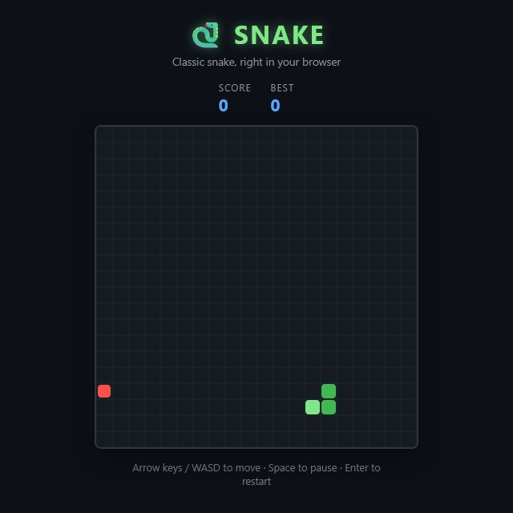

<div align="center">

# 🐍 Snake

**The classic snake game, right in your browser. One page, no install, no ads.**

[🎮 Play now](https://itstomekk.github.io/snake-game/) · [🐞 Report a bug](https://github.com/itstomekk/snake-game/issues) · [𝕏 @itstomekk](https://x.com/itstomekk)

<br>

<a href="https://itstomekk.github.io/snake-game/"></a>

</div>

---

## 👋 Hi!

Steer a snake around a 20 by 20 grid, eat the red food, and do not run into a wall or into yourself. Every bite makes you faster. Beat your best score and try again.

**[Open the game →](https://itstomekk.github.io/snake-game/)** It works on a desktop with a keyboard and on a phone with swipes or the on-screen arrows.

## 🕹️ How to play

| Input | Action |
|---|---|
| Arrow keys or `W` `A` `S` `D` | steer |
| `Space` | pause and resume |
| `Enter` | start again after game over |
| Swipe on the board | steer on a touch screen |
| On-screen arrows | steer on a narrow phone screen |

- 🍎 Each food is worth 10 points.
- ⚡ The snake speeds up with every food, until it reaches top speed.
- 🏆 Your best score is saved in your own browser (local storage). Nothing is sent anywhere.

## 🚦 Status

🟢 **Finished and playable.** It is a small, complete game, served by GitHub Pages from the `master` branch. Nothing else is promised or planned.

## 🤝 Want to help?

Small project, easy to jump in. Ideas that would fit:

- a bug on your device or browser: [open an issue](https://github.com/itstomekk/snake-game/issues)
- a feature or a tweak (new look, sounds, levels): open an issue to talk first, or send a pull request
- just say hi: [@itstomekk on X](https://x.com/itstomekk)

## 🛠️ Under the hood

The whole game is one file, [`index.html`](index.html): HTML, CSS and vanilla JavaScript on a canvas. No framework, no build step, no dependencies.

To run it locally:

```bash
git clone https://github.com/itstomekk/snake-game
cd snake-game
python -m http.server 8000
```

Then open <http://localhost:8000>. You can also open `index.html` directly in a browser.

---

<div align="center">

Made by [Tomek](https://github.com/itstomekk) 🐍

</div>
